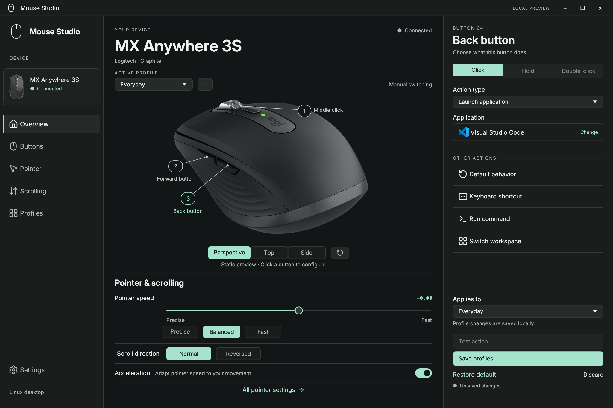

# Mouse Studio

A native settings app for Logitech mice on Linux: remap buttons, build macros, tune pointer and scroll
behaviour, set sensor DPI, and keep different setups per application. Written in Rust with
[egui/eframe](https://docs.rs/eframe/0.33.3/eframe/), for **Arch Linux and Hyprland**.



> **Status: a personal project, early (v0.1.0).** It is built and tested on one Arch + Hyprland machine.
> Several features are implemented from published protocol notes but have **not yet been verified on the
> physical mouse**; they are marked below. It is not affiliated with or endorsed by Logitech.

## What it can do

**Buttons**
- Reassign Back, Forward and Middle click (and, on the MX Master 4, the wheel-mode button, the gesture
  button and the Haptic Sense panel) to: launch an application, run a command, send a keyboard shortcut,
  switch workspace, cycle DPI, or run a macro.
- Separate actions for **Click**, **Hold** and **Double-click** on every button.
- **Macros**: sequences of shortcut taps with delays, with a test and cancel control.
- **Directional gestures** and a **precision mode** (while the button is held, the pointer uses a sensitivity you choose) on any button.
- **Actions Ring**: a radial menu of 2 to 8 actions that opens at the cursor, like Logitech Options+.
  The overlay window is implemented but not yet visually verified.

**Pointer and scrolling**
- Pointer speed and acceleration (adaptive or flat), scroll speed (0.1× to 5×), normal or reversed scrolling.
- Horizontal scrolling with the side wheel (MX Master 4), reversible, restored automatically after wake.
- Side-wheel remapping and haptic feedback on/off and strength for the MX Master 4 (implemented from
  Solaar/logiops protocol notes; **unverified on hardware**).

**Hardware settings** (talks to the mouse directly over HID++, no `logid` required)
- Sensor DPI (200 to 8,000 in steps of 50) with named presets and DPI cycling.
- Ratchet or free-spin wheel mode and SmartShift.
- Live battery level and charging state, and the connection type (Bluetooth, USB receiver, Bolt).

**Profiles**
- Create, duplicate, rename, delete and reset profiles for each mouse.
- **Per-application profiles**: switch automatically by Hyprland window class (`Code`, `brave-browser`, ...).
- Save, discard, import and export as JSON, **restore the previous setup** with one click, and a prompt
  before closing with unsaved changes.
- **Automatic restore**: an optional background service re-applies your profile at login, when the mouse
  reconnects and after a Hyprland reload.

**Interface**
- Real product photos with clickable button markers, plus a rotatable, zoomable 3D model of the
  MX Anywhere 3S. Live indicators show which button you are pressing.
- Dark graphite and mint theme, responsive down to 480 × 480, keyboard shortcut `Ctrl+S` to save.

## Supported mice

| Mouse | Connection | What has been verified on the real device |
|---|---|---|
| **MX Anywhere 3S** | Bluetooth | Pointer and scroll controls, button actions, sensor DPI and cycling, wheel mode, SmartShift, battery |
| **MX Master 4** | Logi Bolt receiver (`046d:c548`) | Pointer and scroll controls, Back/Forward/Middle input, DPI, cycling, wheel modes, SmartShift, battery. Extra buttons, side wheel and haptics: **not yet verified**. Bluetooth: not yet verified |
| **Signature M650 L** | Logi Bolt receiver | Detected and identified. Pointer, button and hardware controls: **not yet verified** |

Each mouse has its own profiles and settings file; switching mice keeps unsaved drafts. See
[docs/multiple-mice.md](docs/multiple-mice.md) for connection requirements and the full support matrix.
Only one mouse of each model can be managed at a time.

## Requirements

- **Arch Linux** (x86_64) with **Hyprland** (developed against 0.56 with the Lua configuration API).
  Pointer settings and button actions are applied through Hyprland, so other compositors are not supported.
- Runtime libraries: `wayland`, `libxkbcommon`, `libglvnd` (all pulled in by Hyprland setups).
- To build: `rust` (cargo), `base-devel`, `git`, `curl`, `python`.
- `udev` rules for hidraw access (installed by a script, below). Never run the app as root.

## Install

### 1. Get the sources and the product images

```bash
git clone https://github.com/MAYO597/Mouse-Studio
cd Mouse-Studio
scripts/fetch-assets.sh
```

The Logitech product photographs and the Visual Studio Code icon are compiled into the app but are **not
stored in this repository** (their owners retain the rights). `scripts/fetch-assets.sh` downloads them from the
official sources and verifies each file's SHA-256. The two Signature M650 L photos cannot be re-downloaded exactly;
the script generates plain placeholders for them, so the build works and the M650 L pages simply show an
empty picture. Copy your own 2560 × 1440 captures over `assets/m650-l/` if you want the photos.

### 2a. Install as an Arch package (recommended)

```bash
sudo pacman -S --needed base-devel rust
scripts/package.sh                                   # builds dist/mouse-studio-0.1.0-1-x86_64.pkg.tar.zst
sudo pacman -U dist/mouse-studio-*.pkg.tar.zst
```

This installs `/usr/bin/mouse-studio`, a desktop entry and icon, and the udev rule. It is a local package, so
rebuild it with the same two commands after you pull changes.

### 2b. Or just build and run it from the checkout

```bash
cargo build --release --locked
./target/release/mouse-studio
```

### 3. Allow the app to talk to your mouse (one time)

Connect the mouse (over Bluetooth, or plug in the Bolt receiver), then run in your own terminal:

```bash
sudo bash /usr/share/mouse-studio/scripts/install-device-access.sh    # package install
sudo bash scripts/install-device-access.sh                            # source checkout
```

The script installs `/etc/udev/rules.d/70-mouse-studio.rules`. It grants the logged-in desktop user access only to
the detected supported mouse over Bluetooth and to the Bolt receiver's HID++ configuration interface (USB
interface 02), not to the receiver's keyboard or mouse interfaces, and nothing becomes world-writable. If you
connect another supported mouse later, run it again. Battery status and the basic desktop controls do not
need this step.

### 4. Start it

Launch **Mouse Studio** from your application menu, or run `mouse-studio`. It opens on the connected supported
mouse; to pick one explicitly:

```bash
mouse-studio --device mx-anywhere-3s      # or: m650-l, mx-master-4
mouse-studio --device mx-master-4 --hardware-status   # print a hardware snapshot (DPI, battery, ...)
```

### Uninstall

```bash
sudo pacman -R mouse-studio                           # the package, if you installed it
sudo rm -f /etc/udev/rules.d/70-mouse-studio.rules    # the access rule from step 3
for s in ~/.config/systemd/user/mouse-studio*-restore.service; do
    [ -e "$s" ] && systemctl --user disable --now "$(basename "$s")"; rm -f "$s"
done
rm -rf ~/.config/mouse-studio                         # your profiles (optional)
```

## Using it

1. Pick your mouse in the dropdown above the sidebar, and a profile at the top of **Overview**.
2. Click a numbered marker on the mouse (or a row on **Buttons**), choose **Click**, **Hold** or **Double-click**,
   then an action type.
3. Adjust **Pointer** and **Scrolling**, and the hardware settings on the same pages.
4. Press **Save profiles** (`Ctrl+S`). Nothing is applied until you save. Use **Test action** to try a button action
   three seconds later, **Discard** to go back, and **Settings → Previous setup** to undo the last save.

Saving a profile that needs a background helper (horizontal scrolling, extra buttons, the Actions Ring,
automatic restore) installs a small systemd user service for that mouse. The full behaviour guide is
[docs/usage.md](docs/usage.md).

Files the app uses:

| Path | What |
|---|---|
| `~/.config/mouse-studio/settings.json` | MX Anywhere 3S profiles (`m650-l.json`, `mx-master-4.json` for the others) |
| `~/.config/systemd/user/mouse-studio*-restore.service` | optional restore services, managed by Save |
| `/etc/udev/rules.d/70-mouse-studio.rules` | hardware access rule from step 3 |

## Development

```bash
cargo fmt --check
cargo test
cargo clippy --all-targets -- -D warnings
```

Tests that need the physical mouse or a live Hyprland session are marked `#[ignore]` and run on request.
`cargo run --example capture` opens a temporary window and saves app-only screenshots to `output/`.

| Path | Contents |
|---|---|
| `src/` | the app: `app.rs` (UI), `model.rs` (profiles, storage), `backend.rs` (Hyprland), `hardware/` (HID++, battery), `software.rs` and `runtime.lua`/`macro.lua` (actions, macros), `ring.rs` (Actions Ring), `preview3d.rs` |
| `tests/`, `examples/` | integration tests and the screenshot capture example |
| `docs/` | feature guides, [`design/`](docs/design) plans and specs, [`research/`](docs/research) notes, [`baseline/`](docs/baseline) UI screenshots |
| `assets/` | fonts, Lucide icons and the 3D model ([`assets/models/`](assets/models/README.md)); product images are fetched, not stored |
| `packaging/`, `scripts/` | PKGBUILD, desktop entry, udev rule, `package.sh`, `fetch-assets.sh`, `install-device-access.sh`, the model generator |

## Credits and licensing

- **No licence has been chosen for this project's own code yet**, so all rights are reserved until one is added.
- Logitech, MX Master, MX Anywhere and Logi Bolt are trademarks of Logitech; Visual Studio Code is a trademark of
  Microsoft. The product images are downloaded by `scripts/fetch-assets.sh` for local use and are not part of this repository.
- Inter and Noto Sans Symbols 2 (SIL Open Font License), Source Sans 3 and the Lucide icons (ISC) are bundled with
  their licence files under `assets/fonts/` and `assets/icons/`.
- The HID++ feature handling follows the public notes of the [Solaar](https://github.com/pwr-Solaar/Solaar) and
  [logiops](https://github.com/PixlOne/logiops) projects.
